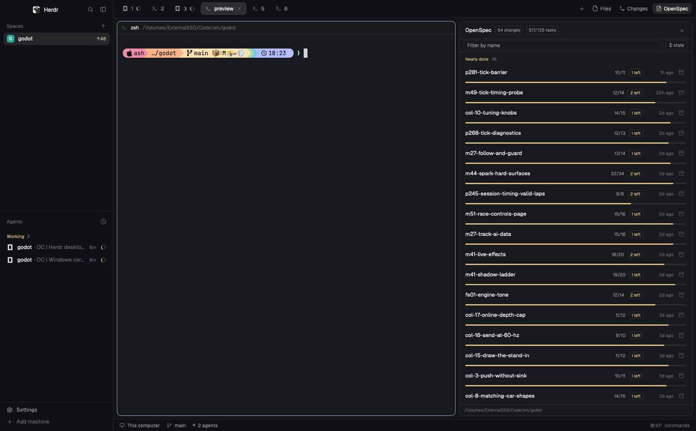
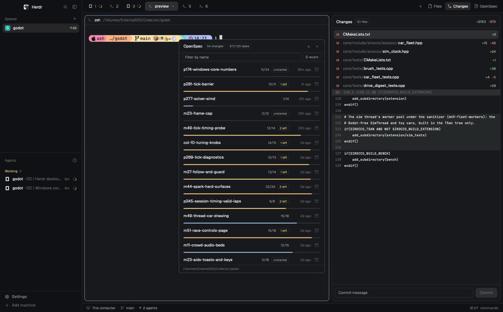

# OpenSpec for Herdr

A live list of your [OpenSpec](https://github.com/Fission-AI/OpenSpec) changes
for the [Herdr](https://herdr.dev) desktop app — what `openspec list` prints,
but always current, in a panel beside your work. Written as a native Herdr
mod: no web view, no server, just small JavaScript the app runs itself.
This repository is itself managed with OpenSpec — see `openspec/specs/` for
the mod's specified behaviour.



Click a change to fold out its task list from `tasks.md`; click a task to
tick or untick it there, and **Mark all N done** ticks every open task in one
write after a second press arms it. With a change viewer open, clicking
another change switches the viewer to it too. Press the box button to archive
a change (`openspec archive`, confirmed twice, reported by toast).
Right-click a change for a menu — **Copy name**, **View change**, then a
divider and five AI commands (**Continue**, **Apply**, **Verify**, **Sync
specs** and **Archive using AI**) handed off to the selected agent, a new tab
or the clipboard, with the panel's status read hiding what cannot apply.
**View change** opens the whole change beside your work in a tabbed viewer:
**proposal**, **design**, **tasks** and **specs**, one tab for each artifact
it has, all in Tokyo Night (the Obsidian theme), drawn by the mod's own
markdown renderer, with a click-to-tick checklist on the tasks tab. Another
**View change** switches that open viewer instead of adding a pane. The
toolbar's **Commands** button carries repo-level commands — today **New
change**, handing off `/opsx-propose` with nothing appended. The list follows
the repository of the terminal you're focused on — including spaces that
live on another machine. Clicking the panel, a viewer or the floating window
does not change that repository; it stays on the last terminal you focused.



## What it shows

- **Header**: the change count and the total tasks done, a refresh button, and
  a close button when it floats.
- **Toolbar**: a filter box (matches change names, case-insensitive, `Esc` or
  the × clears it), a **Commands** button (shown whenever a repository is
  resolved, whatever the change count) whose menu holds repo-level commands —
  today **New change**, which hands off `/opsx-propose` with nothing appended,
  so the command asks what to build — and a sort button that cycles **recent
  → A–Z → % done → state**. The choice is remembered. Header totals follow the
  filtered set.
- **State, at a glance**: every row carries a chip — bright green `✓ complete`
  (the theme's ANSI green; not its `done` status colour, which can be blue),
  blue `N left` when at most 2 tasks remain, `unstarted` (has tasks, none
  done), or `no tasks` (a proposal-only draft) — and the progress bar takes
  the state's color. The **state** sort groups the list under
  ✓ Complete / Nearly done / In progress / Unstarted / No tasks headers,
  each with its count. A complete change reads green all the way down —
  name, count, bar, chip and its task list once expanded.
- **One row per active change**: name, progress bar, `done/total` tasks,
  and when the change was last touched. Rows sort most recent first,
  as `openspec list` does.
- **Right-click a row**: a small menu — **Copy name** puts the change's name
  on the clipboard and a toast confirms it, and **View change** opens a
  pane to the right showing the whole change as tabs: **proposal**,
  **design**, **tasks** and **specs**, only for artifacts the change has.
  When a viewer for this repository and machine is already open, **View
  change** switches the most recently opened one instead of adding a pane;
  a pane opens only when no viewer answers. Every body is rendered in Tokyo
  Night colours by the mod's own markdown renderer (the change's name leads
  as a title; scrollable, padded; not text-selectable), the tasks tab is a
  checklist you can tick from — the panel's compare-and-swap write, local
  panes only — and the footer names the change's directory. A change with
  every task done turns green: its name, the selected tab and a **✓
  complete** chip. It works for remote spaces too. Built to take more items
  later.
  After **Copy name** and **View change**, a divider separates five command
  items: **Continue** (`/opsx-continue <name>`), **Apply** (`/opsx-apply
  <name>`), **Verify** (`/opsx-verify <name>`), **Sync specs**
  (`/opsx-sync <name>`) and **Archive using AI** (`/opsx-archive <name>`).
  Each hands the command off exactly as **Bulk archive** does: to the selected
  agent when it works in this repository, else a new agent tab here, else the
  clipboard. Before the menu opens the panel reads the change's status and
  hides what cannot apply — **Continue** when the change is complete;
  **Apply** and **Verify** until the tasks artifact is done (**Apply** also
  until the row shows open tasks); **Sync specs** until the specs artifact is
  done. **Archive using AI** is always shown. If the status read fails or is
  slow, all five appear, and the menu opens where you right-clicked.
- **Expanded**: the change's task list — ✓ for done, ○ for open, under its
  `tasks.md` section headings. Click a task to toggle its box in `tasks.md`:
  the row flips at once and the counts follow when the new file is read back
  (this machine or the pane's remote one — a remote flip goes through
  herdr-core's exact-text edit on the machine and is checked against a
  re-read). Above the rows, **Mark all N done** ticks every open box in one
  write — N counts the whole `tasks.md`, rows past the 120-row cap included —
  in two presses: the first arms the label as **Mark all N?** for about six
  seconds, the second writes, and the arm lapses on timeout or when the
  panel's open change or task state changes. Opening a
  change's row also switches an open viewer to that change; clicking the open
  row again only folds the tasks away. Task rows show the entry's whole text —
  continuation lines of a wrapped `tasks.md` entry included — wrapped over as
  many lines as it takes; resting the pointer on one shows a styled multi-line
  card with the same full text, named
  with the task's state (✓ done or ○ open) and, on a task card, a
  "✓ Mark done" / "↺ Reopen" button that ticks the task straight from the
  card — in any space; section cards show no button. A too-long section
  heading truncates to the panel and gets the same card, labelled `section`.
  Click the change again to fold it away.
- **Archive** (the box button): first click turns it into a red
  **Archive?** chip; second click runs `openspec archive <name> --yes`. It
  cancels if you click anything else or wait a few seconds. While it runs the
  row shows a spinner, and a toast reports the result. A failure also opens
  an **Archive failed** dialog naming the reason, with **Archive using AI**
  (a new agent tab whose first message is `/opsx-archive <name>`) and
  **Dismiss**; the toast's action opens the same offer. Works on incomplete
  changes too — OpenSpec warns and continues under `--yes`.
- **Bulk archive** (the toolbar button, shown while a repository is resolved
  and at least one active change is listed): hands `/opsx-bulk-archive` to
  the agent you have selected — the one the agent list and agent block show —
  by typing the command into that agent's terminal, on its machine. The
  command's own workflow prompts for the changes to archive, validates each
  one, resolves delta specs that touch the same capability, syncs the main
  specs and archives; the panel itself runs no archive command and does not
  choose the changes. If the selected agent works in another repository or
  cannot be reached, a new tab opens here with its program (or the first
  installed agent); with no agent installed, or a tab that cannot start, the
  command goes to the clipboard instead.
- **Footer**: the folder being read (with the machine's name when it isn't
  this one).

## Live

The panel watches `openspec/changes/`, so a task an agent ticks or a change
it creates appears right away — ticking a task from the panel proves it:
the same watch carries its own write back into the counts. A 15-second poll
covers remote machines (the folder watch is local-only), and switching
spaces or panes re-reads at once.
An open change viewer watches the change's own folder the same way, so edits
to any artifact — `specs/<capability>/spec.md` included — show up as they
happen; remote viewers poll every 15 seconds. Switching a viewer to another
change moves its watch to that change's folder.
It runs `openspec list --json` in the focused repository — on its machine for
remote spaces, the same way Herdr's own panels run `git`.

## Install

You need the Herdr desktop app and the `openspec` CLI on your `PATH`.

Ask your Herdr agent: *"add the mod at
github.com/AshMcConnell/herdr-openspec"*. It reads
[RECIPE.md](RECIPE.md) and the files, copies `mods/openspec/` into
`~/.config/herdr-app/mods/`, and checks it.

Or by hand:

```sh
git clone https://github.com/AshMcConnell/herdr-openspec
cp -R herdr-openspec/mods/openspec ~/.config/herdr-app/mods/
```

Herdr runs its own copy of the mod from `~/.config/herdr-app/mods/`, so a
copied folder is only live once you reload the mod panel in the app — the app
itself needs no restart. Herdr's Files and Changes panels show where one goes:
to open OpenSpec beside a terminal right away:

```sh
herdr-app do pane.split '{"direction":"right","mod":"openspec"}'
```

`pane.split` accepts a fixed folder too, if you want it pinned to one
repository: add `"props":{"folder":"/path/to/repo"}`.

### Updating

An installed copy doesn't update itself.

```sh
cd herdr-openspec && git pull
rm -rf ~/.config/herdr-app/mods/openspec && cp -R mods/openspec ~/.config/herdr-app/mods/
```

Then reload the mod panel in the app: the app runs its own copy, so the new
files are only live once it has re-read them. The app itself needs no restart.

### Dock it like Files and Changes

Herdr's tab bar has **Files** and **Changes** buttons, each opening a side
panel. [docs/top-bar.md](docs/top-bar.md) adds an **OpenSpec** button beside
them (your agent can do it in a minute), by cloning Herdr's `main` layout and
`tabs` mod. Herdr never auto-docks mods into its own shipped layouts — the
clones are how every panel mod docks.

### Or open it as a floating window

Give it a key: in `~/.config/herdr-app/keys.json`, under `"global"`, add

```json
"cmd-alt-o": "mod.open:openspec",
```

Now `cmd-alt-o` opens the list as a small floating window over anything
(press it again to close; the × in its header closes it too). Herdr remembers
where you dropped it, and it comes back with your layout if it was open when
you quit.

## What it runs

The mod runs `openspec` in the repository it follows: `openspec list --json`
(every 15 seconds, when something under `openspec/changes/` changes, and when
you switch pane or space), and `openspec archive <name> --yes` when you press
the archive button's chip. One `git rev-parse --show-toplevel` per switch
finds the repository root for reading and writing `tasks.md` — read with
Herdr's file reader, on the pane's machine for remote spaces. Ticking a task
is a file write, not a command. On this machine `writeTextFile` replaces that
change's `tasks.md` only if it still matches what the panel read (a lost race
rejects the write rather than overwriting anyone). On a remote machine it is
`herdr-core file edit` on the pane's machine: one checkbox line's exact text
is replaced (refused if that line is not unique in the file), and the line is
checked against a re-read before the panel accepts it. **Mark all done** is
the same write once for the whole file: on this machine one compare-and-swap
of every open line at once, and on a remote machine one `herdr-core file
edit` carrying one old/new pair per open line, all-or-none — each old line
checked to appear exactly once before anything is written, and every changed
line verified against a re-read. Either way
the write is only ever at `openspec/changes/<name>/tasks.md` with `<name>`
from the list. It never runs a shell: every call is an argument list, and
change names come from `openspec list`, never typed input. Nothing goes
beyond the machines Herdr already connects.

The **View change** viewer runs `find` to list a change's specs (local and
remote alike) and otherwise adds no programs: it reads `proposal.md`,
`design.md` and `tasks.md` with Herdr's file reader (on the change's machine
for remote spaces) and opens itself with `pane.split`.

Change entries and capability directories whose name begins with a dot are
ignored — `openspec list` reports dot folders as changes, and the viewer's
`find` can return a `spec.md` inside a dot directory, so the panel hides both
(they are hidden, not deleted).

The list, viewer and menu copies find each other, and the failure dialog
finds its toast, through Herdr's shared values (`openspec.viewers`,
`openspec.views`, `openspec.view.ack`, `openspec.view.quiet`,
`openspec.opens`, `openspec.handoff`, `openspec.archive-failed` and
`openspec.archive-dialog`) and the mod's own `view`, `open`, `command` and
`archive-ai` commands — no new programs, no files and no network.

## Limits

- **Archive skips OpenSpec's prompts** (`--yes`), because the mod can't
  answer them: archiving a change with unfinished tasks proceeds with
  OpenSpec's own warning instead of asking.
- **Dot entries are hidden, not deleted** — a change folder or capability
  directory whose name begins with `.` is left out of the list and the specs
  tab; it stays on disk, and it comes back if you rename it.
- **"Archive using AI" needs an installed agent** — with none installed, or
  while the agent list is still loading or cannot be read, the dialog copies
  `/opsx-archive <name>` to the clipboard instead and says so.
- **Bulk archive is a hand-off, not an archive** — the panel never runs
  `openspec archive` for it, does not wait for the agent, and does not report
  the result; the list's folder watch and 15-second poll bring the archive
  back. Only one hand-off is in flight at a time; a press while one is in
  flight does nothing. The command is sent to the selected agent only when
  its live folder is the panel's repository: an agent in another repository,
  or one whose folder cannot be read, instead gets a new tab in this
  repository with the selected agent's program — or the first installed
  agent when that program cannot be resolved. With no agent selected, the
  first installed agent starts in a new tab. When no agent is installed, the
  agent list cannot be read, or the tab cannot start, the command is copied
  to the clipboard instead.
- **Every command is a hand-off, not a run** — the row menu's five commands
  and the Commands menu's **New change** use the same paths and the same
  one-at-a-time rule as Bulk archive; a pick while one is in flight does
  nothing, and the panel never waits for the command or reports its result.
  Sending to an agent that is sitting mid-approval-prompt can land the text
  oddly, and the installed-agent check is cached for up to a minute, so a
  just-installed agent may be missing (the clipboard fallback covers it).
- **Remote spaces poll** every 15 seconds rather than watching files (Herdr's
  folder watch is local-only).
- **Long task rows wrap** — continuation lines of a wrapped task in
  `tasks.md` are folded into their entry — while a too-long section heading
  truncates to the row and shows in full in its hover card; lists past 120
  rows point at the file.
- **The filter matches change names** — not task text or specs.
- **"Nearly done" means at most 2 tasks remain** — a fixed threshold, not a
  percentage; state chips and the state grouping use it.
- **The list follows the last terminal click** — clicking the panel, an open
  viewer or the floating window leaves the folder alone; a different terminal
  or space resolves again, and a restart starts from the focused terminal.
- **Viewer switching follows the newest viewer for the same repository and
  machine** — a row click or **View change** retargets it; viewers for
  another repository, another machine, or an older one are left alone. The
  panel waits 700 ms for the viewer's acknowledgement; a viewer that does not
  answer is skipped for 15 seconds, and **View change** opens a pane if no
  other viewer answers (a row click never opens one). Switching lasts for the
  session: the pane's saved props still name the change it was opened on, so
  a Herdr restart returns it there. Remote change viewers poll every 15
  seconds, reads are capped at 1 MiB, and a pane whose change was archived
  falls back to the proposal tab's *No proposal.md* until closed.
- **The change viewer's checklist is read-only on remote panes** — it renders
  but a click writes nothing (only the panel's fold-out ticks remotely).
- **The change viewer's palette is fixed** — Tokyo Night dark (the owner's
  Obsidian theme), whatever the app theme is; a dark pane in a light theme
  is deliberate. Every body is drawn by the mod's own markdown renderer, so
  the text itself plus headings, links, code and quotes all take theme
  colours; only http(s) links are clickable, and other URLs stay coloured
  but inert; tables, images, deep list nesting and other exotic markdown
  fall back to literal text lines, and the rendered document is not
  text-selectable (the old text view was).

## License

[MIT](LICENSE)
