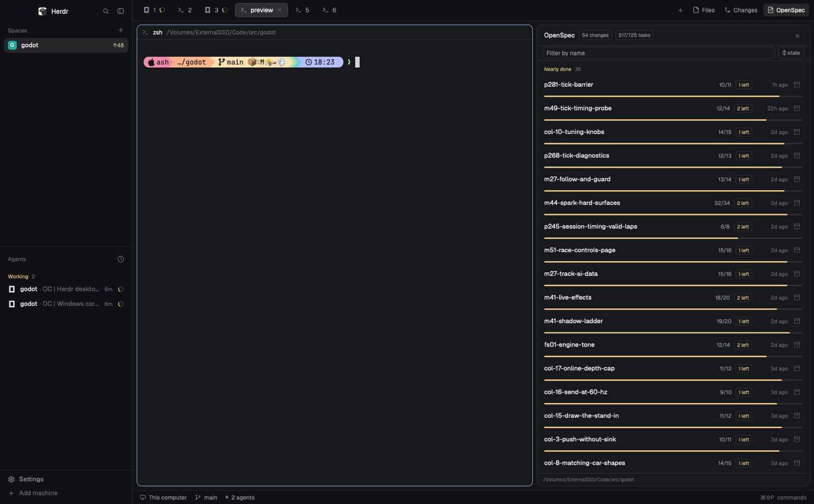

# OpenSpec

A live list of the focused terminal's OpenSpec changes for the Herdr desktop
app: one row per active change (name, progress bar, done/total tasks, a
status chip when it isn't `in-progress`, and its age), newest first, with
header totals. A toolbar under the header has a filter box (change-name
substring; `Esc` or × clears it) and a sort button cycling recent → A–Z →
% done (remembered in the panel's `localStorage` under `"sort"`); the header
totals follow the filtered set. Clicking a row folds out the change's task
list from its `tasks.md` (✓ done, ○ open, section headings). The box button
on a row archives that change: first click turns it into a red "Archive?"
chip, the second runs `openspec archive <name> --yes` and reports by toast.
It reads the repository of the focused pane — else any pane with a folder in
the active space, else the space's folder — running `openspec` there, on its
machine for remote spaces.



It shows itself three ways:

- **A side panel** like Files/Changes when a layout puts it in a block
  (`"content": { "mod": "openspec" }`), or docks it: with
  `"place": "right"` in `mod.json`, Herdr docks a copy the first time it
  sees the folder while a personal (cloned) layout is shown. Shipped
  layouts never auto-dock mods; see [docs/top-bar.md](docs/top-bar.md) for
  the clone recipe.
- **A floating window**: `mod.open {"name":"openspec"}` toggles it
  (`"overlay"` in `mod.json`: 480 px wide, 75% of the window, remembered by
  its `key`, reopened on start if it was open). A keys.json line such as
  `"cmd-alt-o": "mod.open:openspec"` binds a key.
- **A pane**: `herdr-app do pane.split '{"direction":"right","mod":"openspec"}'`.
  A `"props":{"folder":"/path/to/repo"}` pins it to one repository.

## What it runs

- `openspec list --json` in the repository — on refresh (first show, a pane
  or space switch), every 15 seconds, and when Herdr's watch on
  `openspec/changes/` fires (local spaces only; remote spaces get the poll).
- `openspec archive <name> --yes` when the archive chip is confirmed. `--yes`
  is required: the mod has no TTY to answer OpenSpec's prompts, so an
  incomplete change proceeds with OpenSpec's warning instead of asking.
- `git rev-parse --show-toplevel` once per switch, to anchor the watch and
  `tasks.md` reads at the repository root (the folder itself when git fails).

Nothing else: no shell, no network. `readTextFile` reads the expanded
change's `tasks.md`. Change names come from `openspec list`, never from
typed input, and none of the calls can start with `-`.

## Install

Copy this repository's `mods/openspec/` into `~/.config/herdr-app/mods/`:

```sh
git clone https://github.com/AshMcConnell/herdr-openspec
cp -R herdr-openspec/mods/openspec ~/.config/herdr-app/mods/
```

It hot-loads; no restart. Requires the `openspec` CLI on the user's `PATH`
(on every machine whose spaces will show it).

Check it:

```sh
herdr-app check ~/.config/herdr-app/mods/openspec
```

Expect `check passed`. Then verify it shows real data:

```sh
herdr-app do pane.split '{"direction":"right","mod":"openspec"}'
```

In a space whose folder holds an `openspec/changes/` directory, the panel
should list its changes within a second or two. Empty states it may show,
all normal: `No folder` (nothing focused with a folder), `openspec is not
installed`, `No OpenSpec here — run `openspec init`` (the folder has no
`openspec/changes/`), `No active changes`.

### If the person wants it docked beside Files and Changes

Follow [docs/top-bar.md](docs/top-bar.md): clone Herdr's `tabs` mod and
`main` layout, point the clone layout's tab bar at the clone tabs, add an
`openspec` block to the `panel-body` stack, and add the button. Herdr will
not dock mods into its shipped layouts by itself.

### If the person wants a key for the floating window

In `~/.config/herdr-app/keys.json`, under `"global"`, add e.g.
`"cmd-alt-o": "mod.open:openspec",`. The window toggles with the key; the
header's × closes it.

## Uninstall

```sh
rm -rf ~/.config/herdr-app/mods/openspec
```

Plus, if they were added: the `openspec` block in the layout clone's
`panel-body` stack, the button and enabled entry in the cloned tabs mod, and
any `mod.open:openspec` line in `keys.json`.

## Updating

Ask the agent to pull and re-copy, as in the README's
[Updating](README.md#updating) section: the installed copy is a plain
folder, not a git checkout.
